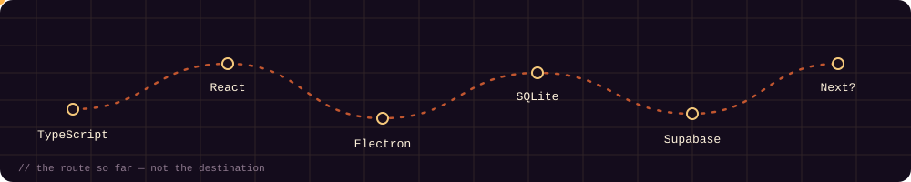

<!-- Copy README.md and the assets/ folder into your github.com/snipy09/snipy09 repo -->

 

 

### The route so far

 

### Currently pitched at

**[Nomadic](https://nomadic.runs-on.dev)** — a desktop career OS. It watches ATS boards in real time, fills applications for you, and helps you reach actual recruiters instead of a black-hole inbox. Electron, React, SQLite, Supabase. Closed alpha.

### Field notes

- Software should save you tabs, not add them.
- Local-first when it matters, cloud when it helps.
- Ship the ugly version, then sand it down.

### Say hi

 

